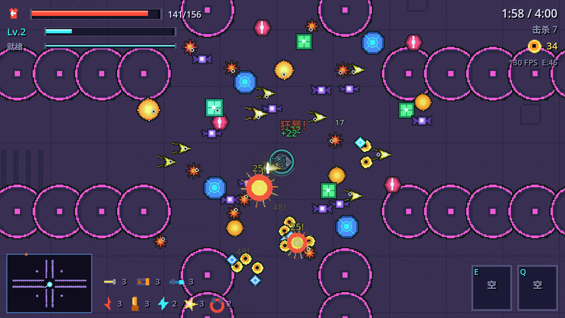
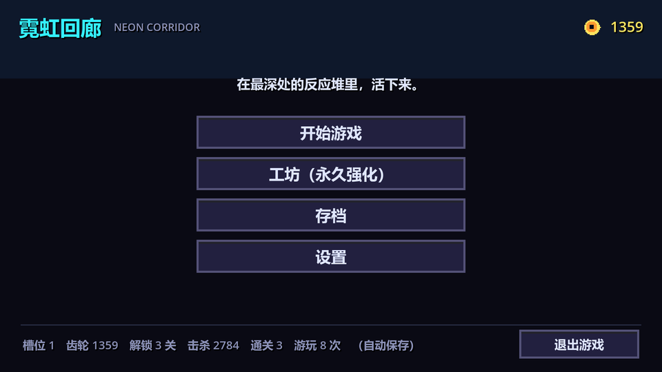
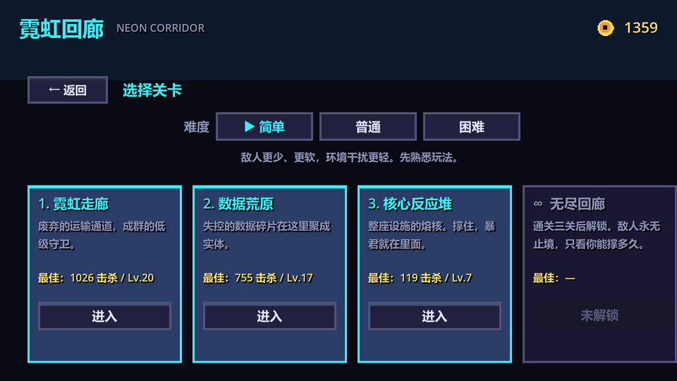
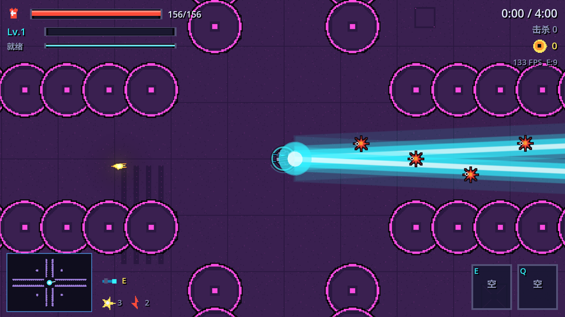
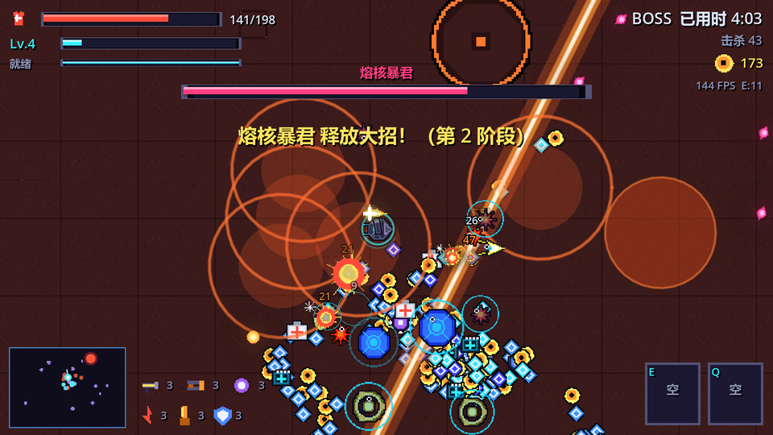
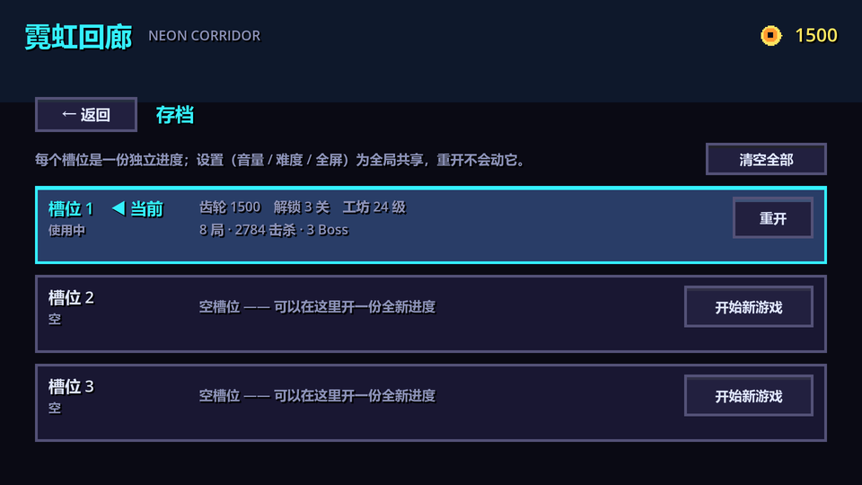

# 霓虹回廊 · Neon Corridor

<p align="center">
  
</p>

<p align="center">
  <a href="LICENSE"></a>
  
  
  
</p>

**像素风 2D 生存射击 Roguelite**。WASD 走位、鼠标瞄准，靠升级三选一越打越强，
在成波敌人和 Boss 里活下来。三关通关后解锁无尽模式。

> 美术、音效、BGM **全部由脚本程序化生成**，工程中不含任何第三方素材（字体除外）。

## 特性

| | |
|---|---|
| **武器** | 6 种武器，每种 5 级，满级 + 指定被动可**进化**（6 种进化形态） |
| **成长** | 升级三选一：武器 / 被动 / 进化 / 主动技能 |
| **主动技能** | 冲击波、护盾力场、相位突进、时滞场（`E` / `Q` 施放） |
| **战术道具** | 护盾电池、脉冲炸弹、时缓芯片、狂暴剂 |
| **关卡** | 3 关 + 无尽模式；3 档难度（简单 / 普通 / 困难）|
| **敌人** | 12 种敌人 + 3 个 Boss，带 4 种精英词缀 |
| **环境危害** | 激光门、风暴区、岩浆口、激光臂、腐蚀池 |
| **存档** | 3 个独立存档槽，工坊永久强化跨局累积 |
| **音乐** | **分层自适应 BGM**：氛围层常驻，战斗层随战况实时淡入 |
| **画面** | 640×360 逻辑分辨率整数缩放，手写空间哈希碰撞，无物理引擎 |

## 截图

| 主菜单 | 选关 / 难度 |
|---|---|
|  |  |

| 战斗 | 激光束 |
|---|---|
|  |  |

| Boss 战 | 存档槽 |
|---|---|
|  |  |

## 快速开始

### 直接运行

从 [Releases](../../releases) 下载 `NeonCorridor.exe`，双击即可，无需安装任何东西。

### 从源码运行

需要 **Godot 4.7**（4.7.x 均可）：

```bash
git clone https://github.com/MUZHUYIN/neon-corridor.git
cd neon-corridor
# 用 Godot 打开 project.godot，按 F5 运行
```

美术与音频已随仓库提供，**开箱即可运行**。
如果要重新生成素材（改了 `tools/gen_art.py` 或 `tools/gen_audio.py` 之后）：

```bash
python tools/gen_art.py     # 需要 Pillow
python tools/gen_audio.py   # 需要 numpy
```

### 自行导出 exe

```powershell
.\tools\build.ps1
```

一键完成：生成素材 → 引擎导入 → 静态语法检查 → 冒烟测试 → 导出单文件 exe。

## 操作

| 操作 | 按键 |
|---|---|
| 移动 | `W A S D` 或 方向键 |
| 瞄准 | 鼠标 |
| 射击 | 自动开火（可在设置里关掉，改为按住左键） |
| 冲刺（带无敌帧） | `空格` |
| 主动技能 | `E` / `Q` |
| 暂停 | `ESC` |
| 全屏 | `F11` |

**一局怎么走**：选关 → 4 分钟波次刷怪 → 5 分 30 秒 Boss 登场 → 击败 Boss 通关。
死亡或通关都会把「齿轮」存进工坊，用齿轮买永久强化，下一局更强。

- **升级**：击杀掉经验宝石，升级时弹出三选一（武器 / 被动 / 进化 / 技能）。
- **进化**：武器满 5 级 + 指定被动到 3 级，就会出现质变进化选项。
- **精英怪**：中后期出现带光环的精英（狂暴 / 护盾 / 畸变 / 传送），掉落更多。
- **宝箱**：波次间隙掉宝箱，开出四选一。
- **复活**：工坊「备用机体」每 2 级给 1 次复活，死了原地满血复活。
- **小地图**：左下角，只显示自己 / Boss / 悬赏目标 / 特殊道具，不显示杂兵。

## 技术要点

- **无物理引擎**：敌人、弹丸、拾取全部走手写空间哈希网格（`CELL = 56`）+ 手写圆/线段相交，
  同屏 190 敌人 + 300 拾取仍能保持 55~70 FPS。
- **流场寻路**：从玩家位置做一次 BFS 得到全场方向场，敌人 O(1) 查表绕墙——
  修复了"玩家在墙一侧、敌人在另一侧却不会绕路"的问题。
- **分层自适应音乐**：每关拆成 `_base`（氛围）+ `_drive`（战斗）两条**等长同速**音轨，
  同一帧启动保持同步，按「身边敌人密度 / 濒危 / Boss / 刚受伤」实时调整战斗层音量。
- **全程序化美术**：`tools/gen_art.py` 用 Pillow 把 110 组动画、291 帧打包进单张 2048² 图集。
- **全程序化音频**：`tools/gen_audio.py` 用 numpy 合成 24 个音效 + 分层 BGM（FFT 滤波 / 卷积混响 / 软限幅）。
- **代码优先**：只有一个 `Main.tscn`，其余节点全部在 GDScript 里构建。

## 工程结构

```
neon-corridor/
  project.godot            工程配置（640×360 逻辑分辨率，2 倍缩放到 1280×720）
  export_presets.cfg       Windows 单文件导出预设（PCK 内嵌）
  src/
    Main.gd                根节点：状态机、场景切换、输入、自测钩子
    Arena.gd               关卡背景：地板/围墙/立柱，圆形碰撞推挤，流场寻路
    World.gd               一局世界的全部逻辑：刷怪、碰撞、掉落、动态难度
    Player.gd  Enemy.gd  Boss.gd  Projectile.gd  Pickup.gd  Beam.gd  Fx.gd  FloatText.gd
    autoload/              Bus(信号) Art(图集) Save(存档) DB(数据表) Audio(声音) UI(界面工厂) Game(全局状态)
    ui/                    Menu / Hud / Minimap / LevelUpPanel / PausePanel / ResultPanel
  assets/
    art/                   atlas.json + atlas_0.png（程序化生成的像素图）
    audio/                 24 个音效 + 7 条分层 BGM 音轨（脚本合成）
    fonts/                 NotoSansSC-VF.ttf（SIL OFL 1.1）
  tools/
    gen_art.py             生成全部像素美术与图标（Pillow）
    gen_audio.py           合成全部音效与 BGM（numpy）
    build.ps1              一键：生成素材 → 导入 → 静态检查 → 冒烟测试 → 导出 exe
    probe.gd               批量 GDScript 语法检查
  docs/screenshots/        README 用截图
  tests/shots/             自检截图（`--shots` 自动生成，不入库）
```

## 想改点什么

**改数值**：几乎所有平衡都在 `src/autoload/DB.gd` 里。
- 加武器 → 往 `WEAPONS` 加一条（图标复用现有的即可）
- 加敌人 → 往 `ENEMIES` 加一条 + 在 `gen_art.py` 的 `build_enemy()` 里加一种画法
- 改关卡节奏 → 改 `STAGES` 里的 `phases`（每段的时间、刷怪速率、敌人池、精英率）
- 加工坊项 → 往 `WORKSHOP` 加一条，并在 `Game.workshop_bonus()` 里接上效果
- 改难度 → `DIFFICULTY` 表（敌人生命/伤害、刷怪速度、同屏上限、齿轮收益）

**重画美术**：改 `tools/gen_art.py` 里对应的绘制函数，然后运行 `tools/build.ps1`。

**重做音乐/音效**：改 `tools/gen_audio.py`，然后运行 `tools/build.ps1`。

## 自测钩子（命令行参数）

游戏内置了自测开关，正常游玩不会触发：

```
--autostart=N   启动后直接开始第 N 关
--frames=N      跑 N 帧后自动退出
--maxt=SEC      游戏内时间到 SEC 秒后自动退出
--skip=SEC      开局把关卡时钟直接跳到 SEC 秒（测后期内容）
--bot           机器人接管操作（自动瞄准最近的敌人、走位、捡东西、放技能）
--testload      直接给满配武器/被动（压测用）
--swarm=N       维持同屏 N 个敌人（压测用）
--shots         自动跑一遍全流程并截图到 tests/shots/
--pathtest      流场寻路的 A/B 对照测试
--savetest      存档槽迁移/切换/重置的回归测试
--audiotest     音频加载与分层联动的自检
```

例：`NeonCorridor.exe --headless -- --maxt=40 --autostart=0 --bot`

## 已知说明

- 游戏逻辑**不依赖 Godot 物理引擎**，敌人/弹丸/拾取全部是手写空间网格碰撞。
- 存档在 `%APPDATA%\Godot\app_userdata\NeonCorridor\save.json`，写坏了会自动备份成 `save.bak.json` 并重建。
- 字体是 Noto Sans SC（SIL OFL 1.1），随工程一起分发。
- 只有 Windows 导出预设；其他平台需要在 Godot 里自行添加。

## 版本管理

| 分支 | 用途 |
|---|---|
| `main` | **正式版本**。只在发布时合并 `dev` 并打标签 |
| `dev` | **日常修改**。所有改动、实验、修复都在这里提交 |

## 更新日志

从 v2 到 v16 的每一轮试玩反馈、根因分析与实测数据，见 **[CHANGELOG.md](CHANGELOG.md)**。

## 许可证

[MIT](LICENSE) —— 代码可自由使用、修改、分发。
内置字体 Noto Sans SC 遵循 [SIL OFL 1.1](https://openfontlicense.org/)。
